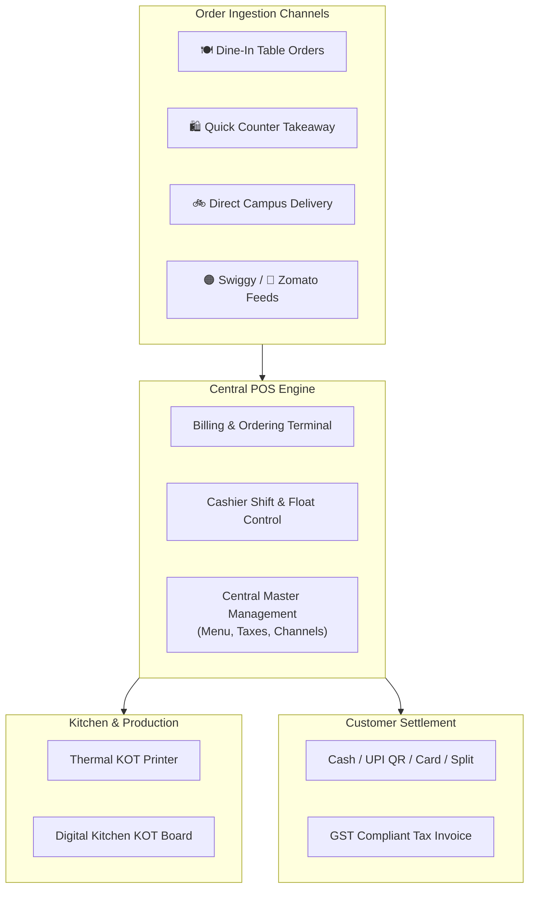
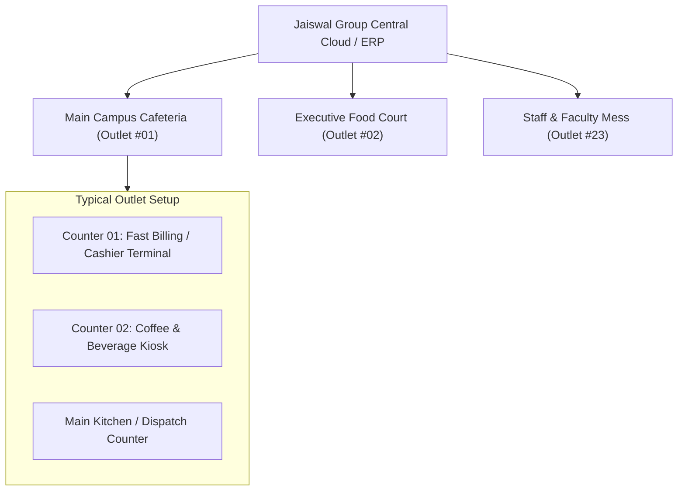
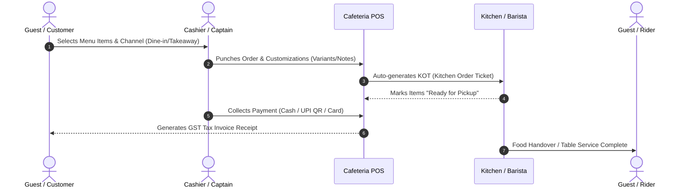
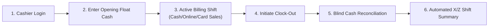
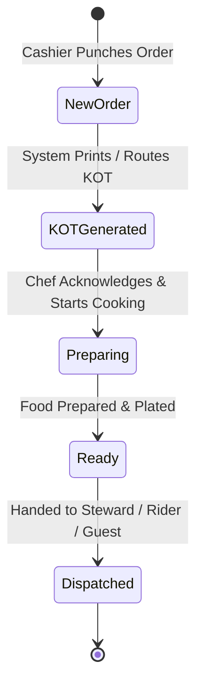
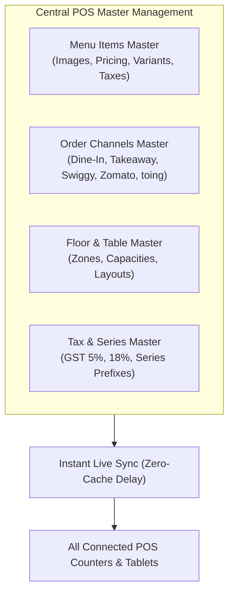

# Jaiswal Group Cafeteria POS — Client Architecture & Operational Guide

An executive, business-friendly guide designed for clients, franchise owners, and operational managers. This document explains how the **Jaiswal Group Cafeteria POS System** operates across multiple outlets, user roles, billing channels, and kitchen workflows.

---

## 1. Executive System Overview

The **Jaiswal Group Cafeteria POS** is a modern, unified Point of Sale (POS) and Restaurant Management solution built to streamline counter operations, table service, kitchen management, and multi-channel online orders in high-volume cafeterias and dining establishments.

### Key Business Highlights
* **Zero Latency Fast Billing:** Designed for peak lunch and tea hours with quick-add items, single-tap variants, and rapid search.
* **Unified Order Engine:** Handles Dine-in, Takeaway, Campus Delivery, and Online Delivery (Swiggy/Zomato) from a single centralized screen.
* **Real-time Kitchen Coordination:** Kitchen stations receive orders instantly via automated Kitchen Order Tickets (KOT) and live Kitchen Display Boards.
* **Strict Cash & Shift Control:** Guarantees cash drawer transparency with mandatory opening float verification and day-end blind cash count audits.

---

## 2. Multi-Outlet & Terminal Architecture

The system is architected to scale effortlessly from a single campus cafeteria to a multi-branch restaurant chain.

### 1. Outlet Configuration
* **Legal Entity & Series:** Each outlet maintains its dedicated legal registration, tax GSTIN, and automated invoice series prefix (e.g., `INV/26-27/0001`).
* **Menu Scoping:** Specific categories or high-demand combos can be customized per outlet while maintaining standardized master recipes centrally.
* **Independent Shifts:** Multiple terminals/counters operate independent cash drawers simultaneously without cross-teller variance.

---

## 3. User Roles & Permission Matrix

The system enforces strict Role-Based Access Control (RBAC) to safeguard revenue and ensure operational efficiency.

| Role | Key Responsibilities | Access Level |
| :--- | :--- | :--- |
| **POS Super Admin** | Central configuration, tax rules, staff creation, outlet masters, system auditing. | **Full System Access** |
| **Store / Outlet Manager** | Menu item pricing, discount approvals, KOT cancellations, day-end shift sign-offs. | **Outlet Wide Management** |
| **Head Cashier / Billing Staff** | Order creation, payment acceptance, cash drawer custody, shift opening/closing. | **POS & Billing Terminal** |
| **Captain / Floor Steward** | Table allocation, guest ordering, item add-ons, table transfer/merging. | **Tables & Order Taking** |
| **Kitchen Staff (Chef/Barista)** | Cooking preparation, KOT ticket status updates (Preparing $\rightarrow$ Ready $\rightarrow$ Served). | **Digital KOT Screen Only** |
| **Delivery Rider** | Pickup verification, customer campus deliveries, cash-on-delivery collection. | **Delivery Status Updates** |

---

## 4. End-to-End Operational Workflows

### 4.1 Shift Lifecycle & Cash Drawer Control

1. **Clock-In & Float Declaration:** Before billing any order, the cashier logs in and inputs the exact physical opening change/cash float.
2. **Shift Audit Trail:** Every sale, refund, card transaction, and cash collection is logged with timestamps and cashier attribution.
3. **Shift Closing (Z-Report):** At shift end, the system performs a blind reconciliation comparing actual physical cash against expected calculated drawer cash, instantly highlighting any surplus or shortage.

---

### 4.2 Dine-In Table Ordering Flow
* **Interactive Table Map:** Visual indicators show real-time table statuses (Vacant, Running KOT, Billed, Reserved).
* **Multi-Round Ordering:** Stewards can append extra dishes or beverages to an active table; the system automatically creates sequential KOT tickets (KOT 1, KOT 2) without duplicating previous items.
* **Table Merging & Shifting:** Seamlessly transfer a running tab from one table to another if guests relocate.

---

### 4.3 Quick-Bite & Counter Takeaway Flow
* **Single-Screen Workflow:** Tailored for express service counters (Tea, Coffee, Sandwiches, Snacks).
* **Express Settlement:** Items are added to the cart, dynamic tax is calculated, and payment is recorded within seconds.
* **Customer Pickup Token:** Prints a compact thermal token number for order collection screens and customer announcements.

---

### 4.4 Online Aggregators (Swiggy / Zomato) Integration
* **Direct Webhook Ingestion:** Orders placed by customers on Swiggy or Zomato flow directly into the Cafeteria POS without requiring separate tablets.
* **Auto-Accept & Prep Timers:** Configurable automatic order acceptance and prep timer sync.
* **Rider OTP Verification:** Seamless verification of courier pickup OTPs directly from the POS interface.

---

## 5. Kitchen Order Ticket (KOT) Management

The KOT pipeline ensures seamless communication between the billing front-desk and food production stations.

### KOT Station Routing
* **Beverage / Barista Station:** Coffee, fresh juices, and bottled drinks print at the beverage counter.
* **Hot Kitchen Station:** Hot meals, meals-combos, and cooked snacks print at the main kitchen printer.
* **Special Instructions & Add-ons:** Guest notes (e.g., *"Less Spicy"*, *"Extra Dip"*, *"No Sugar"*) are prominently highlighted on the ticket to prevent order errors.

---

## 6. Payment Modes & Financial Compliance

| Payment Mode | Flow & Verification | Reconciliation |
| :--- | :--- | :--- |
| **Cash** | Cash drawer pops automatically upon payment entry; change due is calculated instantly. | Reconciled against physical cash drawer at end of shift. |
| **Dynamic UPI QR** | Dynamic UPI QR code generated on the customer screen or receipt for zero-touch digital payment. | Instant digital confirmation tied directly to transaction reference. |
| **Credit / Debit Cards** | POS records card authorization code and terminal bank slip number. | Reconciled with EDC bank terminal batch settlements. |
| **Split Billing** | Guests can split bills equally or pay specific portions by Cash and UPI. | Accurately accounts for multiple tender types per single tax invoice. |
| **Company Credit / Staff Ledger** | Authorized staff or institutional guests charge orders to their prepaid balance or corporate account. | Tracked in the Customer & Credit Ledger module. |

---

## 7. Master Configuration & Real-Time Sync

All masters are managed through the centralized **Master Management** suite:

> [!TIP] **Instant Master Propagation**
> When a manager updates an item price, changes a channel icon, or disables an unavailable dish in **Master Management**, the updates propagate across all cashier counters **instantly** without requiring manual application restarts.

---

## 8. Summary of Benefits for Clients

1. **Enhanced Revenue Protection:** Shift blind-counts and KOT controls eliminate unrecorded food preparation and cash discrepancies.
2. **Speed of Service:** Express counter mode speeds up customer throughput by over 40% during peak meal times.
3. **Consolidated Operations:** Eliminates tablet clutter by uniting Dine-In, Takeaway, and Online food apps on a single screen.
4. **Data-Driven Growth:** Detailed sales summaries, item velocity reports, and shift audits empower leadership with clear business intelligence.
