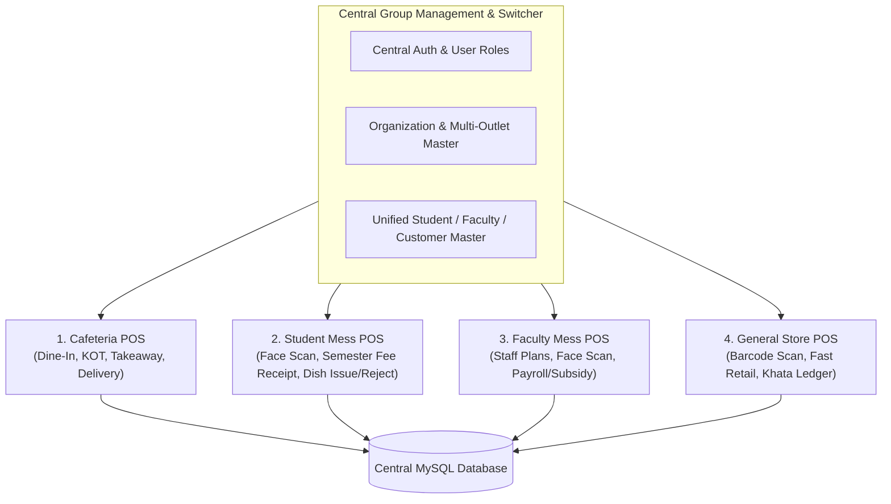
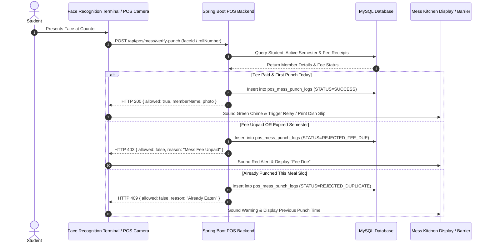
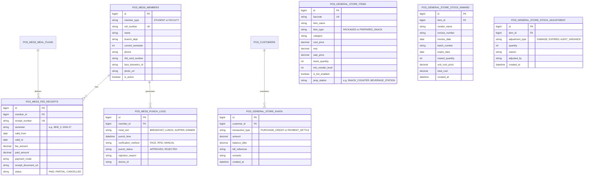
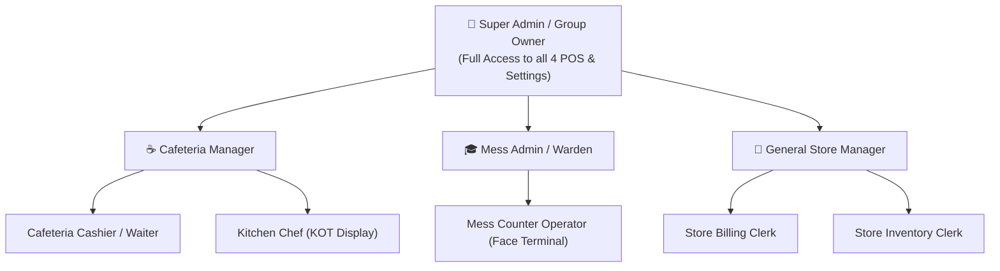
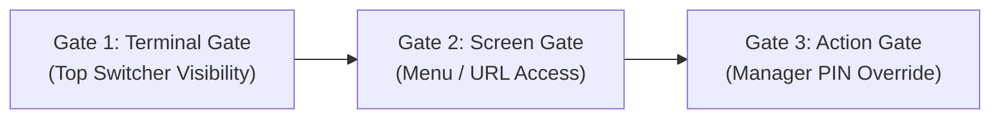

# Jaiswal Group — Multi-POS Unified Platform Architecture Plan
## 4 Specialized POS Systems: Cafeteria, Student Mess, Faculty Mess & General Store

---

## 1. Executive Summary & Vision

This plan defines the end-to-end architecture to expand the current **Cafeteria POS** into a unified **4-in-1 Campus & Hospitality POS Suite** sharing a single database, authenticated backend, and centralized reporting.



---

## 2. The 4 POS System Profiles

### POS 1: Cafeteria POS (Existing & Operational)
* **Target Audience:** Walk-in guests, students, visitors, campus delivery.
* **Core Flow:** Table selection / Counter Takeaway -> Menu item browsing -> Customizations & Addons -> Kitchen Order Ticket (KOT) firing -> Multi-tender billing (Cash, UPI, Card) -> 80mm/58mm Thermal Receipt.
* **Key Features:** Floor plan management, shift handovers with cash denomination counts, advance orders, and Swiggy/Zomato aggregator webhooks.

---

### POS 2: Student Mess POS (Hostel & Campus Dining)
* **Target Audience:** Registered hostelers and day-scholar students enrolled in semester mess plans.
* **Core Problem Solved:** Eliminates unauthorized meals, ghost dining, paper coupon leakage, and manual register entries.
* **Operational Flow:**
  1. **Student Onboarding:** Admin registers student (Roll No, Name, Branch, Semester, RFID Card ID, and captures Face scan / Photo).
  2. **Semester Fee Receipt Entry:** Admin logs mess fee payment (Receipt Number, Semester e.g. Sem 3, Validity Date From–To, Amount Paid, Payment Mode).
  3. **Meal Counter Verification (Face Scan or RFID):**
     - Student approaches the mess counter or turnstile.
     - Face scan machine captures and identifies the student.
     - **Rule Engine Validation:**
       - **Rule A (Fee Status):** Is the student's mess fee paid for the current semester and date range?
       - **Rule B (Active Meal Slot):** Is the current time within an active meal session (Breakfast: 7:30–10:00 AM, Lunch: 12:00–2:30 PM, Snacks: 5:00–6:30 PM, Dinner: 7:30–10:00 PM)?
       - **Rule C (Anti-Passback / Duplicate Check):** Has this student already availed a meal in this specific session today?
     - **Decision Output:**
       - **APPROVED (Green):** "✅ Dish Allowed" -> Screen flashes student photo, name, roll number, and semester. Audio chime "Dish Approved", kitchen token prints or barrier opens, meal counter increments.
       - **REJECTED (Red):** "❌ Dish Rejected" -> Screen shows exact reason: *"Fee Not Paid for Sem 4"*, *"Expired on 15-Nov-2026"*, or *"Already Availed Lunch at 12:42 PM"*. Audio alert buzzes.

---

### POS 3: Faculty & Staff Mess POS (Dining Club & Staff Canteen)
* **Target Audience:** Professors, lecturers, administrative staff, campus security, and visiting guests.
* **Operational Flow:**
  1. Similar Face Scan & ID Card verification as Student Mess.
  2. **Billing Flexibility:**
     - **Prepaid Semester / Monthly Plan:** Verified against fee receipt or monthly subscription.
     - **Institution Subsidy / Payroll Deduction:** Faculty meals logged and sent to HR/Payroll module for month-end salary deduction.
     - **VIP / Guest Meal Punch:** Authorized faculty can punch extra guest plates against their account.

---

### POS 4: General Store POS (Snacks, Packets, FMCG & Stationery)
* **Target Audience:** Open walk-in counter for students, faculty, staff, and campus visitors.
* **No Entry Gate / Turnstile:** Pure walk-up retail counter (no face scan turnstile or entry restrictions required).
* **Dual Item Catalog (Packets vs Fresh Snacks):**
  1. **Packaged Goods & Packets (FMCG):** Chips, biscuits, soft drinks, chocolates, stationery, toiletries, packaged water.
     - Handled via fast USB/Bluetooth barcode scanner or category grid.
     - Instant sale with immediate inventory decrement.
     - *No KOT generated* (shelf product handed over immediately).
  2. **Fresh Prepared Snacks & Hot Beverages:** Hot Samosa, Veg Puff, Sandwiches, Maggie, French Fries, Tea, Coffee.
     - Cashier taps snack button or enters shortcode.
     - **Automated Snack KOT (Kitchen Order Ticket):** Instantly shared/fired to the snack prep station printer or digital KOT screen.
     - **Single Unified Bill:** Both packets and prepared snacks appear on one consolidated customer receipt!
* **Full Stock & Inventory Management:**
  1. **Inward Stock Purchases (GRN):**
     - Record supplier purchase bills with Vendor Name, Invoice #, Batch #, Expiry Date, Cost Price, Selling Price / MRP, and GST rate.
  2. **Real-Time Automated Stock Deduction:**
     - Scanning 1 packet of Lays instantly decreases its inventory by 1.
     - Punching 2 Samosas decreases Samosa stock immediately.
  3. **Low-Stock & Reorder Alerts:**
     - Configurable minimum reorder threshold (e.g. badge alert when Cold Drink cans < 10 or Biscuit packets < 12).
  4. **Stock Wastage / Damage Write-Off:**
     - Log expired packets, damaged goods, or spoiled snacks with mandatory audit reasons.
  5. **Stock Ledger & Movement History:**
     - Live reports for Opening Balance, Stock Inward, Sales Outward, Adjustments/Wastage, and Current Available Stock with total valuation.
* **Settlement & Digital Khata (Credit Ledger):**
  - **Instant Payment:** Cash, UPI QR code, Debit/Credit Card.
  - **Student / Faculty Khata (Udhaar):** Search by Roll No / Phone -> Checks credit limit -> Posts purchase to personal ledger -> Repayment voucher on balance settlement.

---

## 3. Deep Dive: Face Scan Machine & Turnstile Integration

We support **two parallel hardware integration modes**:



### Hardware Integration Options:
1. **IoT Biometric Terminal (Hikvision / Realtime / eSSL / Dahua):**
   - Device connects to campus LAN.
   - When a face is scanned, device fires an instant HTTP Webhook to our Spring Boot endpoint `POST /api/pos/mess/device-webhook`.
   - Backend responds in `< 300ms` with allow/deny signal. If allowed, backend sends turnstile relay signal.
2. **Browser Camera / Tablet Face Recognition (Stand-alone Software Mode):**
   - High-speed camera connected to POS tablet running client-side face matching (via Face-API / TensorFlow.js).
   - Instant visual display on counter screen without needing specialized biometric turnstile hardware.
3. **RFID / ID Card Barcode Fallback:**
   - If face scan is temporarily obstructed, student scans barcode on ID card or taps RFID badge.

---

## 4. Proposed Database Schema (MySQL)



---

## 6. Admin & Role-Based Access Control (RBAC) Architecture

To manage all 4 POS systems securely, we implement a **3-Layer Role & Permission Model**:



### 1. The 6 Defined Roles Across the 4 POS Systems

| # | Role | Accessible Terminals | Allowed Screens & Core Responsibilities |
|---|---|---|---|
| 1 | **Super Admin (Central Owner)** | **All 4 POS** (Cafeteria, Student Mess, Faculty Mess, General Store) | Full control: Users & Roles, GST & Tax Master, Outlets, Consolidated Profit & Loss Reports, System Config. |
| 2 | **Cafeteria Manager** | Cafeteria POS | Item master & pricing, KOT kitchen board, cashier shift auditing, discount overrides, void approvals, daily sales report. |
| 3 | **Cafeteria Cashier** | Cafeteria POS | Punch dine-in & takeaway bills, settle payments (Cash/UPI/Card), shift cash drawer count. *Cannot edit prices or delete orders.* |
| 4 | **Mess Admin (Warden / Hostel Supdt.)** | Student Mess & Faculty Mess | Add/Edit students and faculty, upload & verify **Semester Fee Receipts**, capture Face Scans & RFID, meal timings, dish audit reports. |
| 5 | **Mess Counter Operator** | Student Mess & Faculty Mess | Operate the **Face Scan Terminal**: views green/red validation screen, hands over plate. *Cannot add fee receipts or tamper with student data.* |
| 6 | **General Store Manager** | General Store POS | Supplier purchase inward (GRN), inventory stock adjustments, barcode generation, student Khata credit limits & balance settlement. |
| 7 | **Store Cashier** | General Store POS | Barcode scanning, instant billing, trigger snack KOTs, punch Khata sales. *Cannot modify cost prices or manually alter stock.* |

---

### 2. The 3 Security & Access Gates



1. **Gate 1: Terminal Visibility Gate (Top Switcher):**
   - When a user logs in, the top navigation switcher only shows the POS terminals they are authorized to access.
   - Example: A **Mess Counter Operator** only sees `[ 🎓 Student Mess ] [ 👨‍🏫 Faculty Mess ]`. The Cafeteria and General Store tabs are automatically hidden.
2. **Gate 2: Screen Navigation Gate:**
   - Prevents unauthorized URL typing (e.g. A store cashier cannot navigate to `/users` or `/tax-master`). Protected by React router guards and Spring Boot Security.
3. **Gate 3: Action & PIN Override Gate:**
   - Sensitive actions (such as giving >10% discount, cancelling a live KOT item, writing off damaged stock, or manually overriding an unpaid mess student) prompt for **Manager 4-Digit PIN**.

---

### 3. Database Schema for User & Role Management

```sql
-- Extended pos_users table in MySQL
ALTER TABLE pos_users 
ADD COLUMN assigned_terminals VARCHAR(255) DEFAULT 'CAFETERIA_POS', 
ADD COLUMN allowed_screens TEXT,
ADD COLUMN is_super_admin BOOLEAN DEFAULT FALSE;
```

* **`assigned_terminals`**: Comma-separated list or `*` (e.g., `"STUDENT_MESS,FACULTY_MESS"` or `"GENERAL_STORE"` or `"*"` for Super Admin).
* **`role`**: Enums matching the 7 standard roles.
* **`pin`**: BCrypt-encrypted 4-digit PIN for instant terminal switching at the counter.

---

### 4. Admin Management Workflow (How Admin Manages Staff)

1. Super Admin opens **Master Management -> Users & Roles** (`/master-management?tab=user_master`).
2. Clicks **"+ Add New Staff / Operator"**:
   - **Name & Mobile:** e.g. *"Ramesh Kumar (Hostel Mess Operator)"*
   - **4-Digit Quick PIN:** e.g. `4455` (used for fast counter punch login)
   - **Role Selection:** Dropdown (Cafeteria Cashier, Mess Operator, Store Manager, etc.)
   - **Assigned Terminals Checkboxes:**
     - `☑ Cafeteria POS`
     - `☑ Student Mess POS`
     - `☑ Faculty Mess POS`
     - `☑ General Store POS`
3. Clicks **"Save User"** -> User is instantly active.
4. When Ramesh opens the POS, his counter screen is automatically pre-configured to his role.

---

## 7. Implementation Roadmap

### Phase 1: Multi-POS Switcher & Role Hierarchy
- Add top navigation switcher in Header: `[ ☕ Cafeteria POS ] [ 🎓 Student Mess ] [ 👨‍🏫 Faculty Mess ] [ 🛒 General Store ]`.
- Update `roles.js` and `pos_users` to support `assigned_terminals` so operators only see their allowed POS systems.

### Phase 2: Student & Faculty Mess Backend & UI
- Build `PosMessMemberController` & `PosMessFeeReceiptController` in Spring Boot.
- Implement UI for **Student & Faculty Master**:
  - Add/Edit member with semester, branch, roll number, photo, and RFID.
  - Upload fee receipts with semester validity dates and paid amount.
  - Real-time Fee Status Badges: `● Mess Fee Paid (Sem 4)` vs `● Mess Fee Due / Expired`.

### Phase 3: Face Scan Counter Terminal & Dish Validation Engine
- Enhance `MessPunchTerminal.jsx`:
  - Camera face scanner / Device webhook listener.
  - Instant Rule Evaluation: Fee Check + Meal Slot Check + Anti-duplicate Check.
  - Green / Red Full-screen Visual Display with voice chimes for mess counter staff.
  - Token receipt auto-print for kitchen plate issue.

### Phase 4: General Store POS (Snacks KOT, Packets & Stock Management)
- **Fast Retail Checkout Interface:**
  - Barcode scanner input for packets (Lays, drinks, stationery).
  - Quick touch-grid for fresh snacks (Samosa, puff, tea, sandwiches).
- **Dual KOT & Consolidated Bill Routing:**
  - Fresh snacks generate instant **Snack KOT** for the live cooking station.
  - Packaged items bypass KOT (ready shelf items).
  - Single combined thermal receipt for the customer.
- **Stock Management Engine:**
  - Stock Inward (GRN) module with vendor invoice, batch, and expiry.
  - Real-time auto stock decrement on bill generation.
  - Low-stock badge warnings and stock wastage/damage write-off log.
- **Digital Khata Ledger:**
  - Udhaar credit ledger for students and faculty with repayment tracking.

### Phase 5: Central Reporting & Audit Dashboards
- Cross-POS Day-to-Day Consolidated Report:
  - Cafeteria revenue (Cash/UPI/Cards).
  - Student & Faculty mess plates served (Breakfast, Lunch, Dinner).
  - Fee collection ledger (Semester fee receipts).
  - General Store sales and outstanding Khata receivables.

---

> [!NOTE]
> All 4 POS systems will reuse your existing Spring Boot backend infrastructure (`F:\Dhruvi-sts\jaiswal-backend`) and Vite frontend (`F:\cafeteria-pos` / `F:\restaurant-pos`), keeping database connectivity unified and clean.
